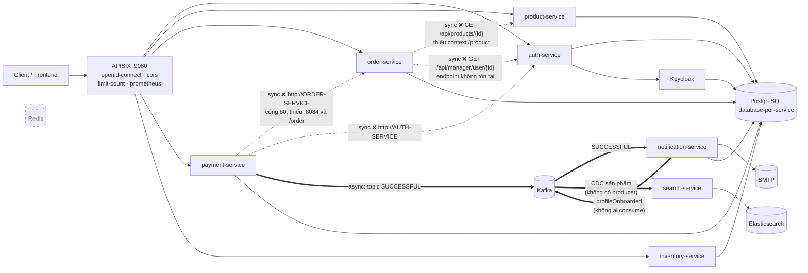
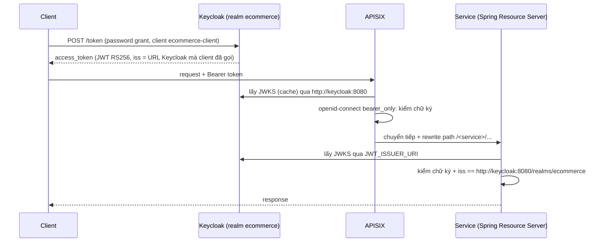

# Kiến trúc hiện trạng (baseline)

> Phase 0 — 0.3. Trạng thái tại tag `baseline-original` (fork từ `hoangtien2k3/ecommerce-microservices`).
> Mọi nhận định đều kèm vị trí trong code để kiểm chứng lại.

## Điều cần nắm

1. **13 service Spring Boot 3.3.5 / Java 21**, Maven multi-module ở thư mục gốc, dùng chung `common-lib`. Mỗi service có **context-path riêng** (`/order`, `/product`…); APISIX viết lại `/api/...` → `/<service>/api/...`.
2. **Database-per-service trên một Postgres duy nhất** (mỗi service một database). Keycloak cũng dùng Postgres này.
3. **Gọi đồng bộ rất ít và đang hỏng:** order → product, order → auth, payment → order, payment → auth. Cả 4 đều **URL viết cứng, sai** (thiếu context-path, thiếu port, endpoint không tồn tại), **không timeout, không retry, không circuit breaker**. Lỗi bị `catch` và nuốt → API vẫn trả 200 với dữ liệu thiếu (đã xác nhận khi chạy e2e).
4. **Bất đồng bộ qua Kafka chỉ có một luồng sống:** payment → topic `SUCCESSFUL` → notification. Các topic còn lại không có producer hoặc không có consumer.
5. **Không có orchestration đặt hàng:** tạo order không trừ kho, không gọi payment. Client tự gọi tuần tự cart → order → payment. Inventory là API tra cứu độc lập.
6. **Redis chạy nhưng không service nào dùng.** Elasticsearch chỉ phục vụ search-service, dữ liệu đồng bộ bằng CDC nhưng stack không có Debezium.
7. **Auth:** Keycloak (realm `ecommerce`) cấp JWT. APISIX kiểm JWT (`openid-connect`, `bearer_only`) cho route ghi; mỗi service **cũng** tự kiểm JWT (Spring Resource Server) — hai lớp kiểm tra, nhưng route đọc product/category là public.
8. **Hệ quả cho roadmap:** các lab resilience dự kiến "Order → Payment/Inventory" **không có lời gọi sync tương ứng**. Lời gọi sync thật để làm timeout/circuit breaker là **Order → Product** và **Payment → Order** (sau khi sửa URL). Cần chỉnh Phase 5 khi tới.

---

## 1. Danh sách service

| Service | Port | Context-path | Database | Liquibase | Ghi chú |
|---|---|---|---|---|---|
| auth-service | 8088 | `/auth` | `authservice` | changelog thật | SSO với Keycloak, quản lý user/role |
| product-service | 8086 | `/product` | `productservice` | **placeholder** `SELECT 1` | category + product; GET public |
| order-service | 8084 | `/order` | `orderservice` | **placeholder** | **cart nằm ở đây** + order |
| payment-service | 8085 | `/payment` | `paymentservice` | **placeholder** | publish Kafka sau khi lưu |
| inventory-service | 8082 | `/inventory` | `inventoryservice` | có script init | chỉ 1 endpoint tra tồn kho |
| notification-service | 8090 | `/notification` | `ecommerce` (dùng chung) | không có | consumer Kafka, gửi email, `ddl-auto: update` |
| shipping-service | 8087 | — | `shippingservice` | placeholder | ngoài core |
| favourite-service | 8081 | `/favourite` | `favouriteservice` | placeholder | ngoài core |
| rating-service | 8089 | `/rating` | `ratingservice` | changelog thật | ngoài core |
| search-service | 8094 | `/search` | — (Elasticsearch) | — | consumer CDC topic sản phẩm |
| promotion-service | 8093 | — | `promotionservice` | changelog thật | ngoài core |
| tax-service | 8091 | — | `taxservice` | changelog thật | ngoài core |
| media-service | 8083 | `/media` | `mediaservice` | changelog thật | object storage RustFS (S3) |

- Mọi service dùng `common-spring` (actuator, Prometheus registry, security cơ sở). `media-service` dùng thêm `common-storage`.
- Actuator chạy trên **cổng quản trị riêng 9000** (`management.server.port`, `common-lib/common-spring/src/main/resources/application.yml:41`), expose `health,info,metrics,prometheus`. Compose không publish cổng 9000.
- Liquibase "placeholder" = `db.changelog-master.yaml` chỉ chứa `SELECT 1;` → schema thực tế do Hibernate `ddl-auto` sinh ra (TD-15).

### Xác minh danh sách core (D1)

| Câu hỏi | Kết luận |
|---|---|
| Giỏ hàng ở đâu? | `order-service` (`/api/carts`) — không có cart-service riêng |
| search-service có trên luồng chính? | Không. Chỉ phục vụ tìm kiếm, cần Elasticsearch + CDC |
| inventory có trên luồng chính? | Không có lời gọi nào tới nó; vẫn **giữ trong core** để Phase 5 thêm lời gọi Order → Inventory (kiểm tồn kho trước khi đặt) làm bài resilience |

→ Danh sách core D1 **giữ nguyên**: auth, product, order, payment, inventory, notification.

## 2. Sơ đồ phụ thuộc



Nét đứt = gọi sync (HTTP) · nét đậm = async (Kafka) · Redis viền đứt = chạy nhưng không ai dùng.

### Chi tiết lời gọi đồng bộ

| Từ → Đến | Code | URL gọi | Vấn đề |
|---|---|---|---|
| order → product | `order-service/.../service/CallAPI.java:26` | `http://product-service:8086/api/products/{id}` | Thiếu `/product` → 404 |
| order → auth | `order-service/.../service/CallAPI.java:17` | `http://auth-service:8088/api/manager/user/{id}` | Thiếu `/auth`; auth không có `/api/manager/user` |
| payment → order | `payment-service/.../service/CallAPI.java` | `http://ORDER-SERVICE/api/orders/{id}` | Tên kiểu Eureka. Docker DNS không phân biệt hoa thường nên **vẫn resolve** ra `order-service`, nhưng không có port → gọi cổng 80 → *connection refused*; còn thiếu `/order` |
| payment → auth | `payment-service/.../service/CallAPI.java` | `http://AUTH-SERVICE/api/manager/user/{id}` | Như trên + endpoint không tồn tại |

Chung cho cả 4: `RestClient` không cấu hình timeout (chờ vô hạn), không retry, không circuit breaker. Resilience4j chỉ có trong `tax-service`, `promotion-service` và `common-spring`.

## 3. Kafka

| Topic | Producer | Consumer | Ghi chú |
|---|---|---|---|
| `SUCCESSFUL` | payment-service (`PaymentServiceImpl.java:120`) | notification-service (`EventConsumer.java:41`) | Tên topic lấy nhầm hằng số **trạng thái** `STATUS_PAYMENT_SUCCESSFUL`; publish cả khi thanh toán chưa thành công |
| `profileOnboarding` | — (code payment đã comment) | notification-service | Không có producer |
| `profileOnboarded` | notification-service | — | Không có consumer |
| `paymentRequest`, `paymentCreated`, `paymentCompleted` | — | — | Khai báo trong `KafkaConstant` nhưng không dùng |
| `${product.topic.name}` (CDC) | — (cần Debezium) | search-service (`ProductSyncDataConsumer.java:23`) | Stack không có Debezium/Kafka Connect |

Rủi ro đáng chú ý:
- **Dual write:** payment lưu DB rồi mới publish Kafka, không có Transactional Outbox → Kafka lỗi thì DB đã ghi nhưng event mất.
- **Consumer group nhầm:** notification đọc `payment.kafka.consumer-group-id` (TD-05) — nếu "sửa" bằng cách khai báo property đó, notification và payment chung group, chia nhau partition.
- **Email cứng người nhận:** notification gửi mọi email thanh toán tới địa chỉ cố định của tác giả gốc (`EventConsumer.java`) — rủi ro lộ dữ liệu nếu cấu hình SMTP thật.

## 4. Luồng xác thực



- Realm import tự động từ `docker/keycloak/import/ecommerce-realm.json`: client `ecommerce-client` (public, bật password grant), user `testuser` (USER), `adminuser` (ADMIN, MANAGER), mật khẩu nằm plaintext trong file.
- **Rủi ro issuer:** token lấy từ host qua `localhost:8080` có `iss = http://localhost:8080/...`, trong khi service kỳ vọng `http://keycloak:8080/...`. Đây là lỗi "split-horizon" kinh điển giữa mạng trong và ngoài.
- auth-service có luồng SSO trình duyệt riêng (`/api/v1/auth/login`, `/callback`, `/refresh`) cho frontend.

## 5. Route APISIX

Cấu hình standalone (YAML, `deploy/apisix/apisix.yaml`, `config_provider: yaml`), mỗi route rewrite `^/(.*)` → `/<context>/$1`.

| Path | Service | Auth ở gateway |
|---|---|---|
| `/api/v1/auth/*` | auth | public |
| `/api/v1/users/*`, `/api/v1/roles/*` | auth | openid-connect |
| `/api/products/*`, `/api/categories/*` | product | **public cả GET lẫn POST/PUT/DELETE** ở gateway (service tự chặn ghi) |
| `/api/carts/*`, `/api/orders/*` | order | openid-connect |
| `/api/payments/*` | payment | openid-connect |
| `/api/inventory/*` | inventory | openid-connect |
| `/storefront/ratings/*`, `/storefront/catalog-search` | rating, search | public |
| `/<service>/v3/api-docs/*` (13 route) | mọi service | **public** — lộ toàn bộ OpenAPI qua gateway |

Global rule: `prometheus`, `cors` (localhost:3000, ecommerce.local), `limit-count` 1200 request/60s theo IP (`policy: local` — đếm riêng từng instance APISIX).

## 6. Critical user journey

Luồng dùng cho k6 (Phase 2), SLO (Phase 8), chaos lab (Phase 5):

```text
lấy token → xem sản phẩm (public) → tạo cart → tạo order (productId, cartId)
→ tạo payment (orderId) → Kafka SUCCESSFUL → notification
```

Chạy thực tế ngày 2026-10-14, profile `core`, qua gateway `localhost:9080`.

| Bước | Kết quả | HTTP | Quan sát / nguyên nhân |
|---|---|---|---|
| 1. Lấy token qua `localhost:8080` | ✅ | 200 | `iss = http://localhost:8080/realms/ecommerce` |
| 2a. Tạo category với token đó | ❌ | 401 | `The iss claim is not valid` — service kỳ vọng `http://keycloak:8080/...` (split-horizon issuer) |
| 2b. Lấy token qua `keycloak:8080` (`curl --resolve keycloak:8080:127.0.0.1`), tạo category gốc | ❌ | 500 | `TransientPropertyValueException`: `CategoryMappingHelper` luôn gán một `parentCategory` rỗng → **không tạo được category gốc qua API** |
| 2c. Chèn category gốc bằng SQL, tạo category con + product | ✅ | 200 | productId = 1 |
| 3. Xem product (public) | ✅ | 200 | Gọi thẳng `:8086/product/api/products` → 200; `:8086/api/products` → 404 (APISIX thêm context-path) |
| 4. Tạo cart bằng `adminuser` | ❌ | 403 | `POST /api/carts` chỉ cho `hasAuthority('USER')`; adminuser có ADMIN, MANAGER — không có USER |
| 4. Tạo cart bằng `testuser` | ✅ | 200 | cartId = 1 |
| 5. Tạo order | ✅ | 200 | orderId = 1; `orderDate` = null |
| 5. Đọc lại order | ⚠️ | 200 | Không có thông tin product: order → product **404** (thiếu `/product`), lỗi chỉ ghi log |
| 6. Tạo payment | ✅ | 200 | paymentId = 1 |
| 6. Payment trùng cho cùng order | ⚠️ | 500 | Đúng là bị chặn, nhưng trả 500 thay vì 409 |
| 6. Payment cho order 999 (không tồn tại) | ❌ | 200 | Vẫn tạo, **vẫn phát event `SUCCESSFUL`** dù trạng thái `NOT_STARTED` |
| 6. Đọc lại payment | ⚠️ | 200 | payment → order lỗi kết nối cổng 80, lỗi chỉ ghi log |
| 7. Kafka → notification | ⚠️ | — | Notification nhận đủ 2 event (lag 0); gửi mail lỗi `Authentication failed` nhưng offset vẫn commit → **event mất, không retry/DLQ** |
| 8. Tồn kho | ⚠️ | 200 | Không liên quan product: tra `IP15` → `[]`; dữ liệu mẫu `Iphone 13` bị **nhân đôi** vì `DataLoader` chèn lại mỗi lần khởi động; product quantity vẫn 10 sau khi đặt hàng |
| 9. Rate limit | ✅ | 200/429 | 1300 request: 1197 × 200, 103 × 429 — đúng `limit-count` 1200/60s |

**Kết luận cho các phase sau:**
- Luồng "happy path" chạy được tới Kafka, nhưng chỉ khi: lấy token qua hostname `keycloak`, dùng `testuser` cho thao tác mua, và có category gốc seed sẵn. Script k6 (Phase 2) phải làm đúng 3 điều này.
- Lỗi bị nuốt khiến **mọi request đều "200"** dù dữ liệu sai → nếu đo SLO chỉ bằng HTTP status thì sẽ ra 100% thành công. Đây là ví dụ cụ thể cho bài SLI ở Phase 8.
- Issuer split-horizon sẽ lặp lại trên K8s (ingress hostname khác service DNS) → giải quyết bằng cấu hình `KC_HOSTNAME` cố định, ghi vào ADR khi làm Phase 2.
